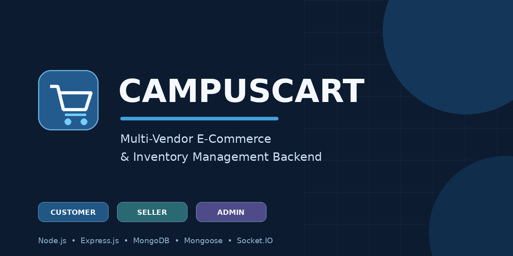
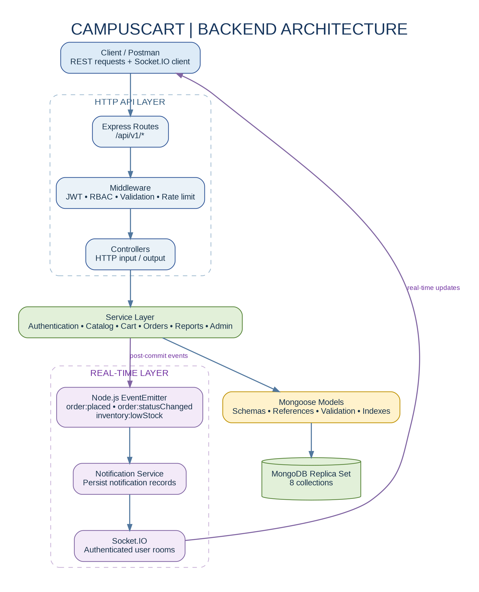
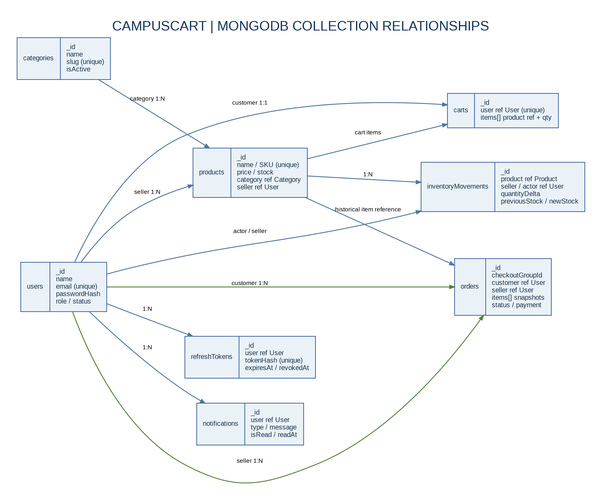
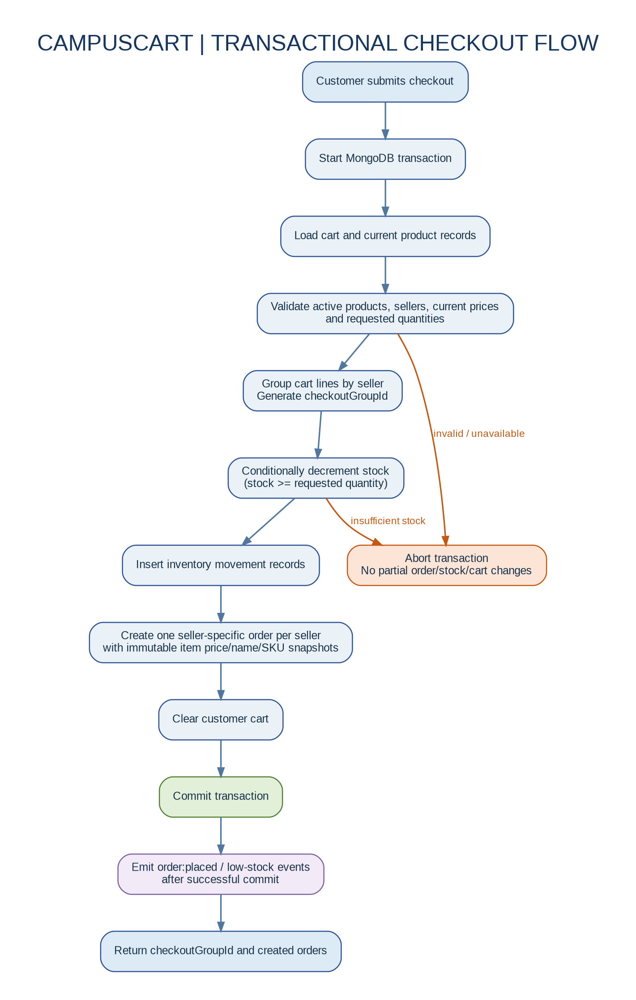
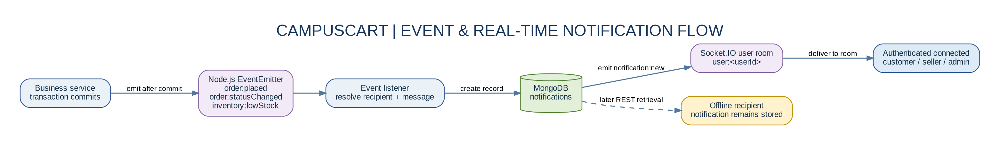

<div align="center">
  
</div>

# CampusCart - Multi-Vendor E-Commerce and Inventory Management Backend

CampusCart is a backend-focused university capstone for **Project 4: E-Commerce and Inventory Management System**. It provides customer, seller and administrator workflows using Node.js, Express.js, MongoDB and Mongoose.

> **Project scope:** This repository contains a backend REST API and real-time notification service, not a customer-facing frontend. API workflows are demonstrated through Postman. Payment is explicitly simulated/not integrated; no real card or banking details are collected.

## Features

- Customer, seller and administrator roles with server-enforced role and resource-ownership authorization.
- bcryptjs password hashing with a 72-byte UTF-8 input limit, JWT access tokens, and hashed refresh tokens with rotation, token-family reuse revocation and session-version invalidation when a seller is suspended.
- Category and product management, seller ownership checks, product search, filters and pagination.
- Customer carts and multi-vendor checkout that creates one seller-specific order per seller under a shared checkout group.
- MongoDB transaction-based checkout and cancellation, conditional stock changes and inventory movement history.
- Sales/order-value, best-selling product and category inventory aggregation reports.
- Node.js EventEmitter events and authenticated Socket.IO notifications backed by persistent MongoDB notification records.
- Centralized JSON error responses, Zod request validation, Helmet, CORS and authentication rate limiting.
- Seed data, Postman collection, OpenAPI specification, integration tests, report and viva material.

## Technology stack

| Area | Technology |
|---|---|
| Runtime | Node.js 20+ (Node.js 22 recommended) |
| API | Express.js 5 |
| Database | MongoDB 7 replica set, Mongoose 8 |
| Authentication | bcryptjs, JSON Web Tokens |
| Validation | Zod |
| Real-time | Node.js EventEmitter, Socket.IO |
| Security / utilities | Helmet, CORS, express-rate-limit, Morgan, dotenv |
| Testing | Node test runner, Supertest, Socket.IO Client, mongodb-memory-server |
| API testing | Postman |

## Architecture

CampusCart uses a modular monolith with separate routes, middleware, controllers, services and models.



### Database relationships



### Transaction-safe checkout



### Real-time notification flow



Editable Graphviz source for these diagrams is kept next to each PNG in `docs/figures/`.

## Prerequisites

- Node.js 20+ and npm.
- Docker Desktop with Docker Compose, or a MongoDB deployment configured as a replica set.
- Postman for manual API demonstration.

MongoDB must be replica-set capable because checkout and cancellation use transactions. The supplied `docker-compose.yml` creates a one-node local replica set for development and testing.

## Installation and local setup

### 1. Install dependencies

```powershell
npm install
```

This generates `package-lock.json` for your local environment. Keep that file in the GitHub repository after installation so future installs can use `npm ci` reproducibly.

### 2. Configure environment variables

```powershell
Copy-Item .env.example .env
```

Edit `.env`: replace both JWT secret placeholders with different private random strings of at least 32 characters, and set `ADMIN_PASSWORD` to a private password of at least 12 characters. The application rejects the example placeholders. Never commit `.env` or paste secrets into screenshots/issues.

### 3. Start MongoDB

```powershell
docker compose up -d mongo
docker compose ps
docker exec campuscart-mongo mongosh --quiet --eval "rs.status().ok"
```

The replica-set status command should return `1`. Default connection URI:

`mongodb://127.0.0.1:27017/campuscart?replicaSet=rs0`

### 4. Create sample data

```powershell
npm run seed
```

The idempotent seed script creates a local administrator, two sellers, three customers, categories and sample products. It adds missing records rather than deleting existing users or products.

### 5. Start the API

```powershell
npm run dev
```

- API base URL: `http://localhost:5000/api/v1`
- Health endpoint: `http://localhost:5000/health`

Production-style start command: `npm start`.

## Development-only demo accounts

| Role | Email | Password |
|---|---|---|
| Admin | `admin@campuscart.local` | Value configured as `ADMIN_PASSWORD` in `.env` |
| Seller | `seller1@campuscart.local` | `CampusCartDemo123!` |
| Seller | `seller2@campuscart.local` | `CampusCartDemo123!` |
| Customer | `customer1@campuscart.local` | `CampusCartDemo123!` |
| Customer | `customer2@campuscart.local` | `CampusCartDemo123!` |
| Customer | `customer3@campuscart.local` | `CampusCartDemo123!` |

These are local evaluation accounts only. Change the administrator password and do not reuse demo credentials outside your development machine. Seeded sellers are active; newly registered sellers start pending until an administrator approves them.

## Testing

### Static syntax check

```powershell
npm run check
```

### Automated integration tests

Start the local replica set, then run the suite against a dedicated test database:

```powershell
$env:TEST_MONGODB_URI = "mongodb://127.0.0.1:27017/campuscart_test?replicaSet=rs0"
npm test
Remove-Item Env:TEST_MONGODB_URI
```

The test suite drops only the database named in `TEST_MONGODB_URI`. Use a dedicated disposable test database, never the development or production database. If `TEST_MONGODB_URI` is not set, the test suite uses `mongodb-memory-server`; its first run may need to download a MongoDB binary.

Tests cover health/auth protection, validation, role restrictions, cart behavior, checkout and cancellation stock handling, refresh-token family replay, seller suspension/session revocation, customer order privacy, failed transaction rollback, concurrent last-unit checkout, and authenticated/unauthenticated Socket.IO behavior. Test coverage is not proof that the suite has passed on every machine: record actual local output in `docs/TESTING.md` after execution.

## Postman

Import these two files into Postman:

- `postman/CampusCart.postman_collection.json`
- `postman/CampusCart.postman_environment.json`

Select the **CampusCart Local** environment and set `baseUrl` to `http://localhost:5000/api/v1`. Run the relevant role's login request before role-protected requests. The collection saves the returned access token in the environment.

## Verification status

`PROJECT_STATUS.md` and `docs/TESTING.md` record what was checked in the authoring environment and what still requires execution on a machine with npm dependencies and replica-set MongoDB.

## Documentation

| File | Contents |
|---|---|
| `START_HERE.md` | Beginner-friendly Windows/VS Code setup and first-run walkthrough |
| `docs/PROJECT_PLAN.md` | Problem statement, objectives, scope, roles and milestones |
| `docs/ARCHITECTURE.md` | Layer responsibilities, request flow, event flow and diagrams |
| `docs/DATABASE_DESIGN.md` | Collections, relationships, indexes and transaction design |
| `docs/API_DOCUMENTATION.md` | Endpoints, roles, input and response expectations |
| `docs/openapi.yaml` | OpenAPI specification |
| `docs/TESTING.md` | Automated and manual test instructions |
| `docs/REQUIREMENTS_TRACEABILITY.md` | Mapping to the university assignment |
| `docs/DEMO_SCRIPT.md` | Suggested faculty demonstration flow |
| `docs/VIVA_PREPARATION.md` | Implementation-focused viva questions and answers |
| `docs/PROJECT_REPORT.docx` / `.pdf` | Editable and print-ready project report |
| `docs/SUBMISSION_CHECKLIST.md` | GitHub and academic submission checklist |
| `docs/screenshots/README.md` | Exact runtime screenshot evidence to capture locally |

## GitHub Actions

A workflow is included at `.github/workflows/ci.yml`. On pushes and pull requests to `main`/`master`, it installs Node dependencies, starts a disposable MongoDB replica set, runs the JavaScript syntax check and executes the integration tests.

## Scope and limitations

The project does not include a frontend UI, genuine payment gateway, courier integration, email/SMS gateway, binary image storage, coupons or recommendation engine. Product images are stored as URL values. Order totals in reports represent order value, not verified payments collected. Payment fields are marked `simulated` / `not_integrated`.

For a production deployment, add TLS, managed secrets, stricter CORS origin configuration, database backups, monitoring, audit retention policies and load/concurrency testing.

## Assignment and academic integrity

This project is based on **Project 4: E-Commerce and Inventory Management System** in the supplied Backend Development Capstone Project Assignment. Each team member should understand and be able to explain their own work and the route → middleware → controller → service → model → MongoDB execution path. Complete `docs/SUBMISSION_CHECKLIST.md` and add genuine runtime evidence before final submission.
