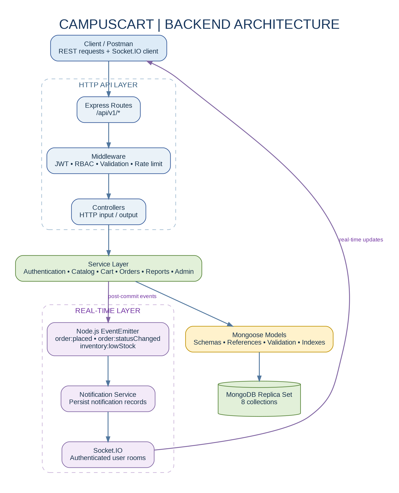
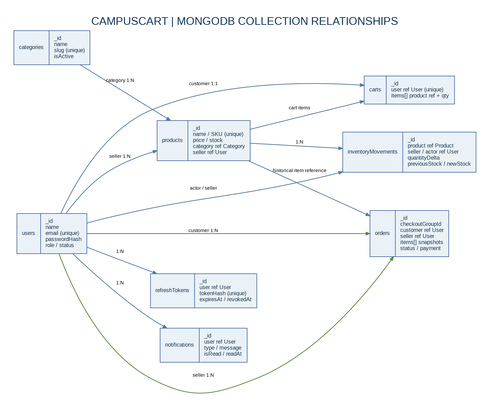
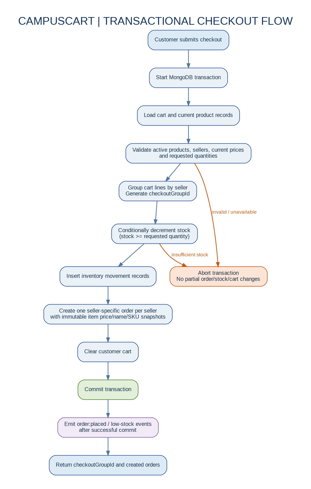
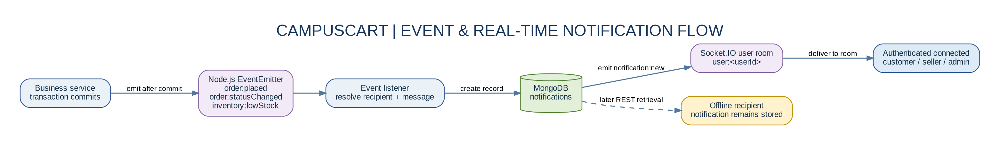

# System Architecture

CampusCart is a **modular monolith**. The HTTP layer is deliberately separated into route modules, middleware and controllers; business rules and request schemas are implemented in the service layer; Mongoose schemas and indexes are defined in the model layer. This separation keeps transport concerns out of the core business workflows.

## Request flow

`Client / Postman -> Express route -> authentication / authorization / parameter validation -> controller -> service -> Mongoose model -> MongoDB -> JSON response`

## Authentication token lifecycle

A successful login creates a refresh-token family with a unique family ID. The server stores only the SHA-256 hash of each refresh token. Rotation revokes the presented token and issues its replacement in the same MongoDB transaction. If a previously rotated token is replayed, the server revokes every still-active token in that family. Seller suspension also increments the account session version and revokes stored refresh records, invalidating access tokens, refresh tokens and socket sessions issued before suspension.

## Main code modules

| Layer | Location | Responsibility |
|---|---|---|
| Server bootstrap | `src/server.js` | Connect to MongoDB, create HTTP server, attach Socket.IO and listen |
| Express app | `src/app.js` | Security middleware, parsers, route mounting, 404 and centralized errors |
| Routes | `src/routes/*.routes.js` | HTTP methods, URL patterns and middleware composition |
| Controllers | `src/controllers/index.js` | Translate request input into service calls and format responses |
| Middleware | `src/middleware/` | JWT authentication, RBAC, rate limiting and route parameter validation |
| Services | `src/services.js` | Request schemas and application/business workflows, called by controllers |
| Models | `src/models/index.js` | Mongoose schemas, references, model methods and indexes |
| Events / sockets | `src/realtime.js` | EventEmitter listeners, persisted notifications and authenticated socket rooms |
| Shared utilities | `src/utils.js` | Errors, async wrapper, response helper, tokens, pagination and slugification |

## Application architecture diagram

## Database relationships

## Checkout consistency

Checkout groups cart items by seller and creates one seller-specific order per seller, linked through a common checkout group ID. The transaction revalidates current product state and price, conditionally decrements stock, creates inventory movement records, creates the order documents and clears the cart. A failed operation aborts the transaction.

## Event and notification flow

After the relevant business transaction commits, the service emits an internal event. Event listeners persist the notification and, when a recipient is connected, send it through the recipient's authenticated Socket.IO user room.

## Deployment topology

Docker Compose runs a single-node MongoDB replica set for local development and transaction testing. The Express API runs on the host by default and connects to `mongodb://127.0.0.1:27017/campuscart?replicaSet=rs0`. Production deployment should use a managed replica set, TLS, secrets management, backups and monitoring.
